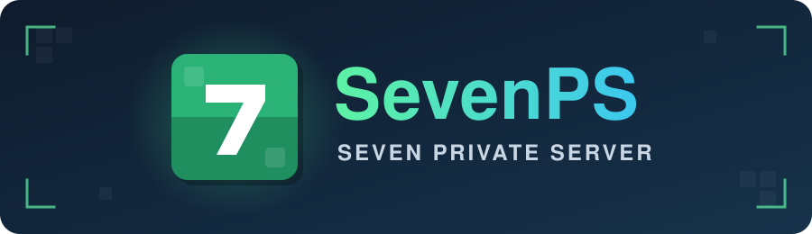

<p align="center">
  
</p>

<p align="center">
  
  
  
  <a href="#license"></a>
  <br>
  <a href="https://sevennxtdoor.github.io/SevenPS/"></a>
  <a href="NOTICE-SEVENPS.md"></a>
</p>

<p align="center">
  <b>Seven Private Server</b>: a Growtopia private server written in C++20, made by @Seven.
</p>

- **Built to behave like the real game.** Trade, vending, surgery, fishing, guilds, area locks, magplants,
  providers, combiners and hundreds of item effects, with numbers checked against the Growtopia wiki.
- **Staff tools that stay safe.** Roles saved in the database, role checks on every staff command, staff log,
  item-leak rules for moderators.
- **Secure login.** HTTPS login server, PBKDF2-SHA256 password hashes, rate limits, daily database backups.
- **Tested offline.** A harness runs the real server code against a fake network, hundreds of tests per build.
- **Discord bot.** Live server status, announcements, staff log and account linking in Discord.

Everything SevenPS adds or changes is listed in [`NOTICE-SEVENPS.md`](NOTICE-SEVENPS.md).

> **Disclaimer:** SevenPS is a fan-made, non-commercial project for learning. It is not affiliated with,
> endorsed by or connected to Ubisoft or Growtopia. Growtopia and its names are trademarks of their owners.
> This repository contains no game files or assets from Ubisoft (no `items.dat`, images or sounds), and
> nothing in SevenPS is sold for real money.

## Requirements

- [MSYS2](https://www.msys2.org/) (Windows) with the UCRT64 toolchain:
  ```bash
  pacman -S --needed mingw-w64-ucrt-x86_64-{gcc,openssl} make
  ```
- [MariaDB Server](https://mariadb.org/download/) (the server stores players and worlds in it)
- Linux instead: `build-essential libssl-dev libmariadb-dev` (Debian/Ubuntu) or `base-devel openssl mariadb-libs` (Arch)

## Database

Give the server its own MariaDB user, never `root`:

```sql
CREATE USER 'sevenps'@'localhost' IDENTIFIED BY 'a-long-random-password';
CREATE USER 'sevenps'@'127.0.0.1' IDENTIFIED BY 'a-long-random-password';
GRANT ALL PRIVILEGES ON sevenps.* TO 'sevenps'@'localhost';
GRANT ALL PRIVILEGES ON sevenps.* TO 'sevenps'@'127.0.0.1';
FLUSH PRIVILEGES;
```

Then put the login in `mysql_login.txt` next to the server (the password may not contain `|`):

```
host|127.0.0.1
user|sevenps
password|a-long-random-password
```

The server makes the `sevenps` database and its tables on the first start. Keep MariaDB on
`bind-address=127.0.0.1` so it can't be reached from the internet.

## Build

**Windows** (from the project folder, in any bash):

```bash
MSYSTEM=UCRT64 /c/msys64/usr/bin/bash.exe -lc "cd '$PWD' && make -j\$(nproc) OS=Windows_NT binary=main_new.exe"
```

`OS=Windows_NT` is needed when the shell doesn't set it, or the Makefile links the Linux ENet library.
Building `main_new.exe` works while `main.exe` is running. In VS Code, **Ctrl+Shift+B** runs "Build SevenPS".

**Linux**: `make -j$(nproc)` builds `main.out`.

## Run

- **Windows**: `jalankan_server.bat`. It installs a fresh `main_new.exe` as `main.exe`, starts it,
  and starts it again after an in-game `/restart`.
- **Linux**: `./main.out`

Ports: **UDP 17091** for the game (ENet; the `port` in `server_data.php`) and **TCP 443** for the login server.

To play on your own PC, point the game's server addresses at it in the **hosts** file
(`C:\Windows\System32\drivers\etc\hosts`, or `/etc/hosts`):

```
127.0.0.1 www.growtopia1.com
127.0.0.1 www.growtopia2.com
```

## TLS certificate (login page)

The game opens its login page over HTTPS, so the login server needs a certificate that the PC running the
game trusts. This repository ships no certificates or keys (they are git-ignored), so you need to make your own.
If you skip this step, login fails with "certificate unknown", error 404, or the game sends you to the real Growtopia.

**1. Make your own CA and server certificate** (once, from the project folder, in MSYS2 or Git Bash).
The CA is *name-constrained*: it can only vouch for `growtopia1.com` and `growtopia2.com`, so trusting
it cannot be abused for other websites.

```bash
export MSYS2_ARG_CONV_EXCL='*' MSYS_NO_PATHCONV=1   # stops MSYS2/Git Bash from rewriting "/CN=..." into a path
cd resources/ctx

openssl req -x509 -newkey rsa:2048 -nodes -days 3650 \
  -keyout sevenps-ca.key -out sevenps-ca.crt \
  -subj '/CN=SevenPS Local CA (growtopia1 and growtopia2 only)/O=SevenPS' \
  -addext 'basicConstraints=critical,CA:TRUE,pathlen:0' \
  -addext 'keyUsage=critical,keyCertSign,cRLSign' \
  -addext 'nameConstraints=critical,permitted;DNS:growtopia1.com,permitted;DNS:growtopia2.com'

openssl req -newkey rsa:2048 -nodes -keyout sevenps.key -out sevenps.csr \
  -subj '/CN=www.growtopia1.com/O=SevenPS'
printf 'basicConstraints=critical,CA:FALSE\nextendedKeyUsage=serverAuth\nsubjectAltName=DNS:www.growtopia1.com,DNS:www.growtopia2.com\n' > sevenps.ext
openssl x509 -req -in sevenps.csr -CA sevenps-ca.crt -CAkey sevenps-ca.key -CAcreateserial \
  -days 825 -out sevenps.crt -extfile sevenps.ext

openssl verify -CAfile sevenps-ca.crt sevenps.crt   # should print: sevenps.crt: OK
rm sevenps.csr sevenps.ext sevenps-ca.srl
```

The server uses `resources/ctx/sevenps.crt` + `sevenps.key` when both exist; at start it prints
`[web] certificate: resources/ctx/sevenps.crt`. Restart the server after making them. The server
certificate lasts 825 days; run the last three `openssl` commands again to renew it with the same CA.

**2. Trust the CA on every PC that plays.** Copy **only** `sevenps-ca.crt` (never a `.key` file) and,
in an admin terminal:

```powershell
certutil -addstore Root sevenps-ca.crt
```

Or double-click it → *Install Certificate* → *Local Machine* → *Place all certificates in the following store*
→ *Trusted Root Certification Authorities*.

**3. Point the hosts file at the server** (see [Run](#run)): `127.0.0.1` on your own PC, or the server's
address for friends. Check it with `ping www.growtopia1.com`; if it still answers with a Growtopia/Akamai
address, the hosts file was not applied (some antivirus programs remove these lines: add them again and run
`ipconfig /flushdns`).

Keep `sevenps-ca.key` private: anyone who has it can make certificates that your players' PCs trust for
`growtopia1.com`/`growtopia2.com`.

## Files next to the server

| File | What it is |
|---|---|
| `mysql_login.txt` | MariaDB login (see above). Secret, git-ignored |
| `server_data.php` | Address, port, maintenance text and login page the game gets. Made on the first start |
| `items.dat` | The game's item list. Not included (it belongs to Ubisoft): copy it from your own Growtopia install |
| `resources/` | Login page, store, ranks, prize tables, punch effects and other data the server reads |
| `resources/ctx/` | TLS certificate and key for the login server. The keys are git-ignored, never upload them |
| `reset_password.txt` | Forgotten password: write `growid|new password` in it and start the server. It is deleted after use |
| `backup/` | Automatic database dumps (`sevenps_*.sql`, newest 7 kept). Git-ignored: they hold password hashes |

Passwords are stored as PBKDF2-SHA256 hashes and can't be read back, not even by the owner; use
`reset_password.txt` instead.

The Owner role is only given in the database:
`UPDATE peer SET role = 3 WHERE growid = 'YourName';` (1 = Moderator, 2 = Developer, 3 = Owner).
Owners and Developers can then use `/setrole` in game.

## Tests

An offline harness runs the real server code with a fake network against the local MariaDB
(it makes a test world `MTTEST` and deletes it again). Build the server first, then:

```bash
MSYSTEM=UCRT64 /c/msys64/usr/bin/bash.exe -lc "bash '$PWD/test/run.sh'"
```

`test/item_audit.sh` lists the items in `items.dat` per type.

## License

SevenPS is a modified version of Gurotopia (© gurotopia, 2024). Gurotopia's original code stays
under the Apache License 2.0, see [`LICENSE`](LICENSE).

The SevenPS changes (© 2026 Seven, all rights reserved) may be read and studied, but **using, copying,
modifying or hosting them needs permission first**. Ask on Discord: **feelingsarefake or iseven_99**.

The changes and other credits are in [`NOTICE-SEVENPS.md`](NOTICE-SEVENPS.md).
